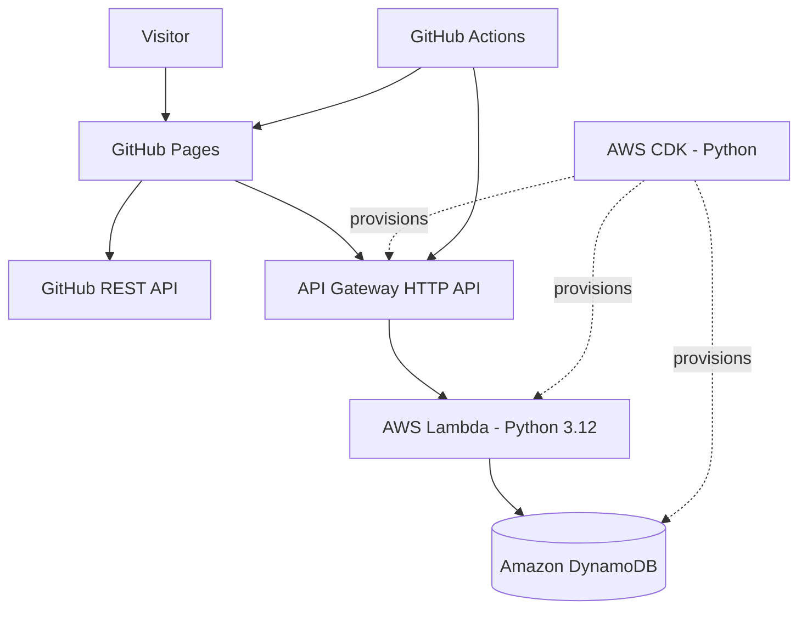

# Serverless Portfolio

A personal developer portfolio built with AWS serverless services, Python, and infrastructure as code. Alongside showcasing projects, it demonstrates a working API, persistent shared pixel-art canvas, automated deployments, and cloud infrastructure managed with AWS CDK.

**[View Live Portfolio](https://aimanhaizal.github.io/serverless-portfolio/)** · **[View Source Code](https://github.com/aimanhaizal/serverless-portfolio)**

## Project Highlights

- **Portfolio frontend** — responsive, dark terminal-inspired design.
- **GitHub integration** — dynamically retrieves public repositories using the GitHub REST API.
- **Serverless backend** — API Gateway HTTP API and AWS Lambda, written in Python.
- **Visitor counter** — stores and retrieves counter data using Amazon DynamoDB.
- **Shared pixel-art canvas** — lets visitors draw and save artwork to a shared canvas backed by the API.
- **Infrastructure as code** — AWS resources are defined using AWS CDK in Python.
- **Automated delivery** — GitHub Actions deploys the frontend to GitHub Pages and periodically refreshes the visitor-count snapshot.
- **Reproducible development setup** — a pinned Python dependency lockfile supports consistent local installation and testing.

## Architecture



## API Endpoints

The deployed API base URL is configured in `frontend/config.js`.

| Method | Endpoint | Purpose |
|---|---|---|
| GET | `/health` | Check API health |
| GET | `/visitors` | Retrieve and update the visitor counter |
| GET | `/visitors/current` | Retrieve the current visitor count |
| GET | `/canvas` | Retrieve the shared pixel-art canvas |
| PUT | `/canvas` | Save the shared pixel-art canvas |

The visitor counter records endpoint activity, not unique people.

## Technology Stack

| Area | Technologies |
|---|---|
| Frontend | HTML, CSS, JavaScript |
| Repository integration | GitHub REST API |
| API | Amazon API Gateway HTTP API |
| Compute | AWS Lambda, Python 3.12 |
| Storage | Amazon DynamoDB |
| Infrastructure | AWS CDK, Python |
| Testing | pytest |
| Hosting and CI/CD | GitHub Pages, GitHub Actions |

## Repository Structure

```text
serverless-portfolio/
├── .github/
│   └── workflows/
│       ├── pages.yml
│       └── visitor-snapshot.yml
├── backend/
│   └── app.py
├── frontend/
│   ├── assets/
│   ├── config.js
│   ├── index.html
│   ├── script.js
│   ├── styles.css
│   └── visitor-count.json
├── infrastructure/
│   ├── app.py
│   └── stack.py
├── tests/
├── cdk.json
├── package.json
├── package-lock.json
├── requirements.txt
├── requirements-dev.txt
├── requirements-dev.lock
└── README.md
```

## Run Locally

### Prerequisites

- Python 3.10 or later
- Node.js and npm for the CDK tooling
- AWS credentials and the AWS CDK CLI if deploying infrastructure

### 1. Clone the repository

```bash
git clone https://github.com/aimanhaizal/serverless-portfolio.git
cd serverless-portfolio
```

### 2. Create a virtual environment

```bash
python3 -m venv .venv
source .venv/bin/activate
```

On Windows PowerShell:

```powershell
.venv\Scripts\Activate.ps1
```

### 3. Install dependencies

For the pinned development and test environment:

```bash
python -m pip install -r requirements-dev.lock
```

Alternatively, install from the declared dependency ranges:

```bash
python -m pip install -r requirements-dev.txt
```

### 4. Run tests

```bash
pytest -q
```

### 5. Start the frontend

```bash
python -m http.server 8000 --directory frontend
```

Open [http://localhost:8000](http://localhost:8000).

The frontend's live visitor counter and shared canvas require the deployed API to be reachable. The API's CORS configuration includes the portfolio origin and the local development origin.

## Configuration

### Frontend API URL

The browser reads its API base URL from `frontend/config.js`:

```javascript
window.PORTFOLIO_CONFIG = {
  apiBaseUrl: "https://YOUR_API_ID.execute-api.ap-southeast-1.amazonaws.com"
};
```

Replace the example URL with the base URL reported by your CDK deployment. Do not append an endpoint path such as `/visitors` or `/canvas`.

This URL is public configuration, not a secret. The browser must know the endpoint to call it, and visitors can inspect the deployed JavaScript or download the source code.

### Visitor snapshot workflow

The GitHub Actions workflow `.github/workflows/visitor-snapshot.yml` uses the repository variable `API_BASE_URL`.

Configure it in **Settings → Secrets and variables → Actions → Variables**. Set it to the API base URL without an endpoint path. The workflow appends `/visitors/current`.

The frontend configuration and GitHub Actions variable must point to the same deployed API. If the API endpoint changes, update both locations.

## Deployment

### Deploy the frontend

The frontend is hosted on GitHub Pages through `.github/workflows/pages.yml`. Push frontend changes to `main` or manually run the workflow from the repository's Actions tab.

Review changes before committing:

```bash
git diff --check
git status -sb
```

Then commit and push the relevant files:

```bash
git add frontend
git commit -m "describe your change"
git push origin main
```

For workflow changes, stage the relevant file under `.github/workflows/` as well.

Check the Actions tab to confirm the deployment succeeds.

### Deploy AWS infrastructure

The AWS CDK application is configured by `cdk.json` at the repository root. Run CDK commands from the repository root, not from `infrastructure/`.

Ensure the Python dependencies and AWS CDK CLI are installed, and configure valid AWS credentials for the intended account and region.

Review the proposed changes first:

```bash
cdk diff
```

Deploy only after reviewing the proposed changes:

```bash
cdk deploy
```

The deployment outputs include `PortfolioApiUrl`. If the API endpoint changes, update `frontend/config.js` and the GitHub Actions repository variable `API_BASE_URL`.

AWS deployments and API traffic can incur charges. Review deployed resources and monitor billing and usage.

## Operational Notes and Security

- **Public API:** the API endpoint is publicly discoverable and its routes are callable by external clients. The URL itself is not a credential.
- **CORS limitations:** CORS restricts browser-based cross-origin access; it is not authentication and does not prevent requests from command-line tools or other HTTP clients.
- **Abuse and cost:** repeated requests can increase usage. The visitor counter can be called repeatedly, and the shared canvas can be overwritten by other callers. Consider rate limiting or additional protections if abuse becomes a concern.
- **IAM permissions:** the Lambda function has permissions for its visitor-counter DynamoDB table. These permissions do not make the public API routes private.
- **Snapshot fallback:** if the live visitor API is unavailable, the frontend can use the saved `frontend/visitor-count.json` snapshot. The displayed value may be stale.
- **Shared canvas:** saved artwork is shared with other visitors. Changes to the board affect everyone using it.
- **Data retention:** the DynamoDB table uses a `RETAIN` removal policy. Deleting the CDK stack does not automatically delete that table. Review retained resources before cleanup or redeployment.
- **Credentials:** never commit AWS access keys, session tokens, passwords, or other secrets. Keep local credentials and environment files out of version control.
- **Dependency lockfile:** `requirements-dev.lock` pins the Python development and test dependency set. Regenerate it with pip-tools when intentionally updating dependencies.

## License

The project code is released under the MIT License. See [`LICENSE`](LICENSE) for details. AWS services, third-party dependencies, and other external resources remain subject to their respective terms and licenses.
