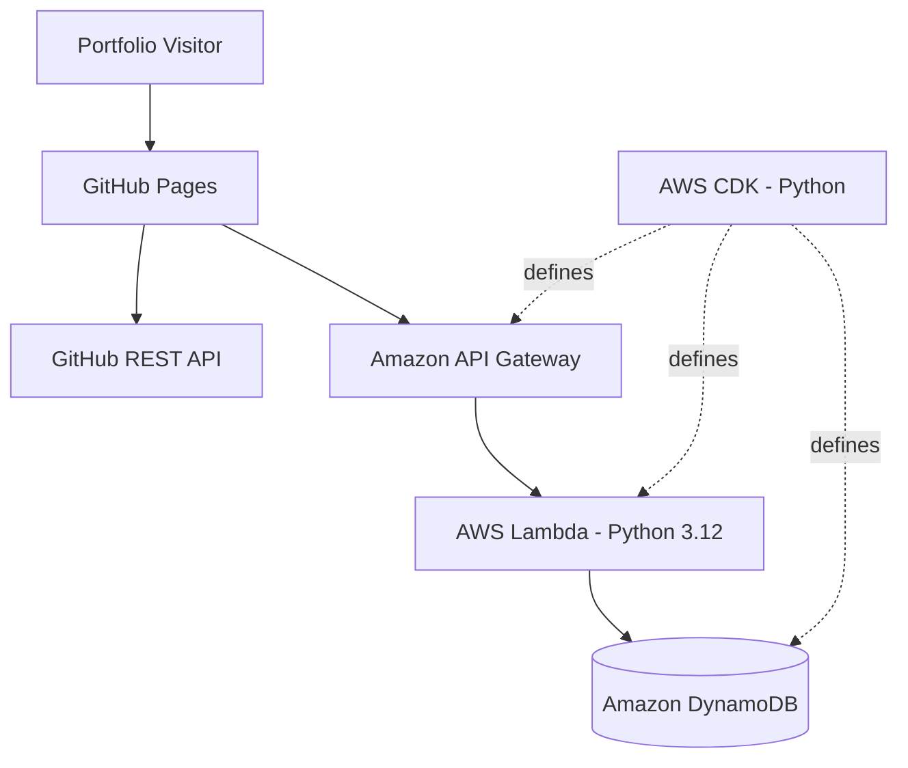

# Serverless Portfolio

A developer portfolio built with AWS serverless services, Python, and infrastructure as code. The site showcases public GitHub repositories and includes a live visitor counter backed by an AWS API.

**[View Live Portfolio](https://aimanhaizal.github.io/serverless-portfolio/)** · **[Browse the Source Code](https://github.com/aimanhaizal/serverless-portfolio)**

## Overview

This project brings together a responsive static website and a serverless backend to demonstrate practical cloud development.

- **Portfolio website** — responsive, dark terminal-inspired design.
- **GitHub integration** — fetches public repositories dynamically from the GitHub API.
- **Serverless API** — AWS API Gateway routes requests to an AWS Lambda function written in Python.
- **Visitor counter** — stores and retrieves a counter using Amazon DynamoDB.
- **Infrastructure as code** — AWS resources are defined using AWS CDK in Python.
- **Automated deployment** — GitHub Actions deploys the frontend to GitHub Pages.

## Architecture



### Request flow

1. GitHub Pages serves the portfolio frontend.
2. The frontend fetches public repository information from GitHub.
3. The frontend calls the backend API for visitor-counter data.
4. API Gateway routes requests to the Lambda function.
5. Lambda reads or updates the counter in DynamoDB.

The visitor counter records endpoint hits; it is not a count of unique people.

### API endpoints

| Method | Endpoint | Purpose |
|---|---|---|
| GET | `/health` | Check API health |
| GET | `/visitors` | Retrieve and update the visitor counter |

**API base URL:** `https://vwrhwdy26e.execute-api.ap-southeast-1.amazonaws.com`

Health check:

```bash
curl https://vwrhwdy26e.execute-api.ap-southeast-1.amazonaws.com/health
```

Visitor counter:

```bash
curl https://vwrhwdy26e.execute-api.ap-southeast-1.amazonaws.com/visitors
```

## Tech Stack

| Area | Technologies |
|---|---|
| Frontend | HTML, CSS, JavaScript |
| Repository integration | GitHub REST API |
| API | Amazon API Gateway |
| Compute | AWS Lambda, Python 3.12 |
| Database | Amazon DynamoDB |
| Infrastructure as code | AWS CDK, Python |
| Testing | pytest |
| Hosting and deployment | GitHub Pages, GitHub Actions |

## Project Structure

```text
serverless-portfolio/
├── .github/
│   └── workflows/
│       └── pages.yml
├── backend/
│   └── app.py
├── frontend/
│   ├── index.html
│   ├── script.js
│   └── styles.css
├── infrastructure/
│   └── stack.py
├── tests/
├── cdk.json
├── requirements.txt
└── README.md
```

## Run Locally

### Prerequisites

- Python 3.10 or later
- Node.js, if required by your local CDK setup
- AWS CDK CLI for infrastructure work
- AWS credentials configured if accessing or deploying AWS resources

### 1. Clone the repository

```bash
git clone https://github.com/aimanhaizal/serverless-portfolio.git
cd serverless-portfolio
```

### 2. Create and activate a Python virtual environment

```bash
python3 -m venv .venv
source .venv/bin/activate
```

On Windows PowerShell, activate it with:

```powershell
.venv\Scripts\Activate.ps1
```

### 3. Install Python dependencies

```bash
python -m pip install --upgrade pip
pip install -r requirements.txt
```

### 4. Start the frontend

```bash
python -m http.server 8000 --directory frontend
```

Open [http://localhost:8000](http://localhost:8000) in your browser.

The frontend's backend integration requires the deployed API to be reachable. The API's CORS configuration allows the local development origin.

## Run Tests

With the virtual environment activated:

```bash
pytest -q
```

To check for whitespace errors before committing:

```bash
git diff --check
```

## Deploy the Frontend

The frontend is hosted on GitHub Pages and deployed using the GitHub Actions workflow in `.github/workflows/pages.yml`.

After making and reviewing changes:

```bash
git add README.md
git commit -m "docs: improve project README"
git push origin main
```

Check the repository's **Actions** tab to confirm the Pages deployment completes successfully.

## Deploy the AWS Infrastructure

The AWS backend is defined in the `infrastructure/` directory using AWS CDK.

After configuring AWS credentials and installing the project's dependencies and CDK CLI, review the proposed changes before deploying:

```bash
cd infrastructure
cdk diff
cdk deploy
```

Run CDK commands from the directory containing the relevant CDK application configuration. If your setup expects the application to be invoked from the repository root, use that configured working directory instead.

AWS deployments can incur charges. Review the resources and estimated costs before deploying or changing infrastructure.

## Security

- Do not commit AWS access keys, session tokens, passwords, or other secrets.
- Keep local virtual environments, generated CDK output, and cache files out of version control.
- Review IAM permissions and infrastructure changes before deployment.

## License

No license has been specified yet. Unless a license is added to this repository, others should not assume they have permission to reuse, modify, or redistribute its code.
