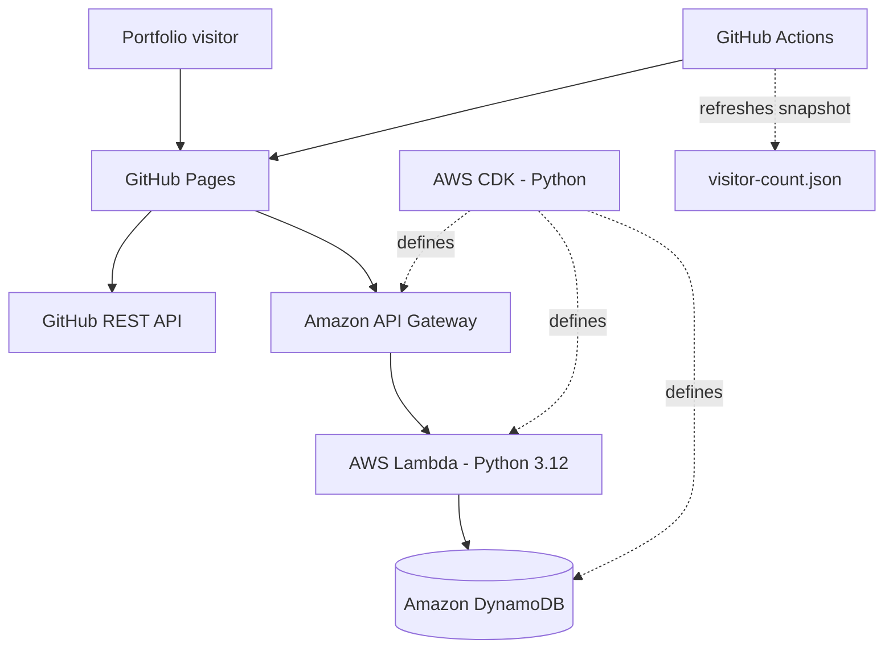

# Serverless Portfolio — Built on AWS

A personal developer portfolio with a little more going on behind the scenes: it pulls in live public GitHub repositories, tracks portfolio visits through a serverless API, and lets visitors contribute to a shared pixel-art canvas.

The project is both a portfolio and a practical cloud engineering exercise. It brings together a static frontend, a Python API, managed NoSQL storage, infrastructure as code, automated deployment, and a small interactive feature that makes the backend tangible.

**[View the live portfolio](https://aimanhaizal.github.io/serverless-portfolio/)** · **[Explore the source code](https://github.com/aimanhaizal/serverless-portfolio)**

---

## What it does

- **A live developer portfolio** — a responsive, terminal-inspired site hosted on GitHub Pages.
- **GitHub repository integration** — retrieves public repository information from the GitHub REST API.
- **Serverless visitor counter** — uses API Gateway, Lambda, and DynamoDB to record and retrieve counter data. The counter measures endpoint hits, not unique people.
- **Shared pixel-art canvas** — visitors can draw on a 16 × 16 grid using four colours. Clearing resets the local draft; saving sends the drawing to the backend so the shared board can be loaded by other visitors.
- **Infrastructure as code** — AWS resources are defined in Python with AWS CDK.
- **Automated publishing** — GitHub Actions deploys the frontend to GitHub Pages and periodically refreshes a visitor-count snapshot.

## Architecture



### Request flow

1. GitHub Pages serves the static frontend.
2. The frontend fetches public repository information directly from GitHub.
3. Frontend API requests reach API Gateway, which invokes the Python Lambda function.
4. Lambda reads or updates records in DynamoDB.
5. The canvas endpoint stores one shared 256-cell drawing. The browser keeps edits local until the visitor chooses **Save to shared board**.

The website and AWS backend are deployed separately: GitHub Actions publishes the frontend, while CDK manages the AWS resources.

## API reference

**API base URL:** `https://vwrhwdy26e.execute-api.ap-southeast-1.amazonaws.com`

| Method | Route | Purpose |
|---|---|---|
| `GET` | `/health` | Basic API health check |
| `GET` | `/visitors` | Updates and returns the visitor counter |
| `GET` | `/visitors/current` | Reads the current count without incrementing it |
| `GET` | `/canvas` | Returns the shared pixel-art canvas |
| `PUT` | `/canvas` | Saves the shared canvas |

### Try the endpoints

```bash
curl https://vwrhwdy26e.execute-api.ap-southeast-1.amazonaws.com/health
curl https://vwrhwdy26e.execute-api.ap-southeast-1.amazonaws.com/visitors/current
curl https://vwrhwdy26e.execute-api.ap-southeast-1.amazonaws.com/canvas
```

The canvas contains 256 cells, each represented by a palette index from `0` to `3`. The `PUT /canvas` endpoint expects a valid canvas payload as implemented in `backend/app.py`.

## Tech stack

| Area | Technologies |
|---|---|
| Frontend | HTML, CSS, JavaScript |
| Repository data | GitHub REST API |
| API | Amazon API Gateway HTTP API |
| Compute | AWS Lambda, Python 3.12 |
| Database | Amazon DynamoDB |
| Infrastructure as code | AWS CDK, Python |
| Tests | pytest |
| Website hosting | GitHub Pages |
| Automation | GitHub Actions |

## Repository layout

```text
serverless-portfolio/
├── .github/
│   └── workflows/
│       ├── pages.yml
│       └── visitor-snapshot.yml
├── backend/
│   └── app.py
├── frontend/
│   ├── index.html
│   ├── script.js
│   ├── styles.css
│   └── visitor-count.json
├── infrastructure/
│   └── stack.py
├── tests/
├── cdk.json
├── requirements.txt
├── LICENSE
└── README.md
```

## Run the site locally

### Prerequisites

- Git
- Python 3.10 or later
- A modern browser
- Access to the deployed API if you want to test live backend features

### 1. Clone the repository

```bash
git clone https://github.com/aimanhaizal/serverless-portfolio.git
cd serverless-portfolio
```

### 2. Create a Python virtual environment

Linux/macOS:

```bash
python3 -m venv .venv
source .venv/bin/activate
python -m pip install --upgrade pip
pip install -r requirements.txt
```

Windows PowerShell activation:

```powershell
.venv\Scripts\Activate.ps1
```

### 3. Start the static frontend

From the repository root:

```bash
python -m http.server 8000 --directory frontend
```

Open [http://localhost:8000](http://localhost:8000).

The frontend can be previewed locally without deploying anything. Live API features require the configured AWS API to be reachable and the browser origin to be allowed by the API's CORS settings.

## Run the tests

With the virtual environment activated, from the repository root:

```bash
pytest -q
```

Before committing, you can also check for whitespace errors:

```bash
git diff --check
```

## Deploy the frontend

The frontend is hosted on GitHub Pages. The workflow at `.github/workflows/pages.yml` publishes it when relevant frontend files or the workflow change on `main`; it can also be run manually from the repository's **Actions** tab.

1. Commit and push your changes to `main`.
2. Open the repository's **Actions** tab.
3. Confirm the Pages workflow finishes successfully.
4. Visit the [live portfolio](https://aimanhaizal.github.io/serverless-portfolio/).

The visitor snapshot workflow at `.github/workflows/visitor-snapshot.yml` runs on a schedule and can be triggered manually. It reads the current visitor count and updates `frontend/visitor-count.json` when the snapshot changes.

## Redeploy the AWS backend

The AWS stack is defined in the CDK application configured by `cdk.json` at the **repository root**. Run CDK commands from that root unless you have deliberately changed the app configuration.

### First-time setup on a new machine or AWS environment

1. Install Git, Python, Node.js/npm, the AWS CLI, and the AWS CDK CLI.
2. Clone this repository and enter its root directory.
3. Create and activate the Python virtual environment, then install the project's dependencies as described above.
4. Configure AWS authentication for the target account. Verify the identity before deploying:

   ```bash
   aws sts get-caller-identity
   aws configure get region
   ```

5. Ensure the configured region is `ap-southeast-1`, or explicitly set it for the session:

   ```bash
   export AWS_DEFAULT_REGION=ap-southeast-1
   ```

6. Bootstrap CDK if the target account and region have not already been bootstrapped:

   ```bash
   cdk bootstrap aws://YOUR_AWS_ACCOUNT_ID/ap-southeast-1
   ```

   Replace `YOUR_AWS_ACCOUNT_ID` with the account you intend to use. Bootstrapping is normally needed once per account/region, and requires sufficient IAM permissions.

### Review and deploy

From the repository root:

```bash
cdk diff
cdk deploy
```

Review the diff and confirm the AWS account and region before approving deployment. `cdk diff` previews infrastructure changes; it does not validate every permission or guarantee that deployment will succeed.

**What this deploys:** the CDK-managed AWS resources and the backend code packaged by the stack. It does not publish the GitHub Pages frontend; that is handled by GitHub Actions.

### Existing resources and data

- The DynamoDB table is configured with a retain policy. Removing the CDK stack may leave the table and its data behind.
- A retained table can affect a later attempt to recreate the stack, because the physical table may already exist.
- Deploying the stack does not restore data that has been deleted or recreate a previous canvas from Git history.
- Treat `cdk destroy` as a potentially consequential operation. Inspect the stack and data-retention implications before using it.

For a full recovery, check the CloudFormation stack, DynamoDB table, API Gateway endpoint, and GitHub Pages deployment separately rather than assuming one command recreates every part of the project.

## Cost and operational notes

This project uses managed AWS services. Usage, configuration, account status, and applicable free-tier or credit terms can affect charges; check the AWS Billing console and current service pricing before deploying or leaving resources running.

The API and database are in the `ap-southeast-1` (Singapore) region in the current deployment. If you deploy to a different account or region, verify the resulting endpoint and update the frontend configuration if necessary.

## Security

- Never commit AWS access keys, session tokens, passwords, or other secrets.
- Use least-privilege IAM permissions appropriate for the deployment.
- Keep local virtual environments, generated CDK output, and cache files out of version control.
- Review `cdk diff` before deploying changes.
- Do not assume an API endpoint is private merely because it is part of a portfolio project; validate input and consider abuse and cost exposure.

## License

The project's code is released under the **MIT License**. See [`LICENSE`](LICENSE) for the full license text. AWS services, third-party dependencies, and external resources remain subject to their own terms and licenses.
